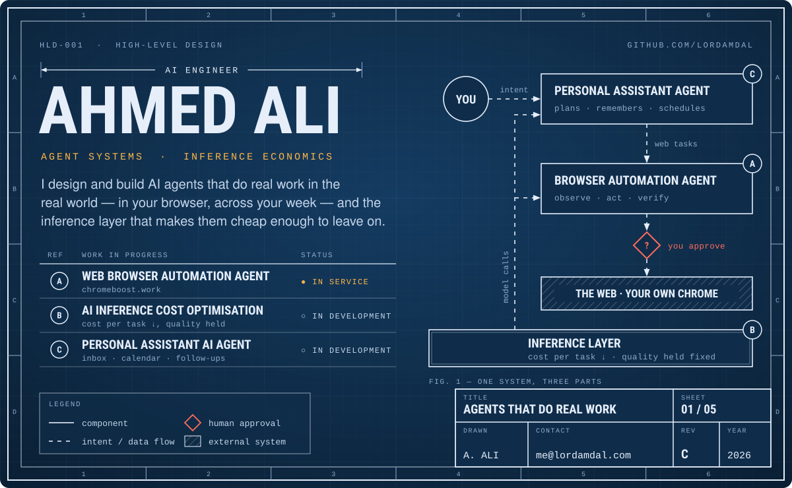
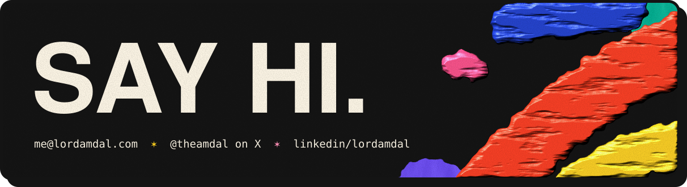

  

  <a href="mailto:me@lordamdal.com"><picture><source media="(prefers-color-scheme: dark)" srcset="assets/btn-email-dark.svg" /></picture></a>
  <a href="https://x.com/theamdal"><picture><source media="(prefers-color-scheme: dark)" srcset="assets/btn-x-dark.svg" /></picture></a>
  <a href="https://linkedin.com/in/lordamdal"><picture><source media="(prefers-color-scheme: dark)" srcset="assets/btn-linkedin-dark.svg" /></picture></a>
  <a href="https://chromeboost.work"><picture><source media="(prefers-color-scheme: dark)" srcset="assets/btn-site-dark.svg" /></picture></a>

  

  

  

  <a href="https://github.com/lordamdal/chromeboost"><picture><source media="(prefers-color-scheme: dark)" srcset="assets/btn-repo-dark.svg" /></picture></a>
  <a href="https://www.cloudskillsboost.google/public_profiles/f1db2574-b763-4a4a-ac8e-02038d9c93cf"><picture><source media="(prefers-color-scheme: dark)" srcset="assets/btn-gcp-dark.svg" /></picture></a>

  

